<p align="center">
  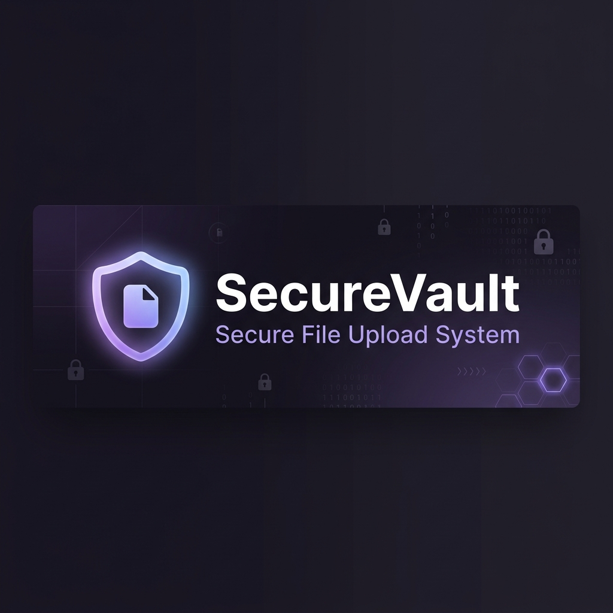
</p>

<p align="center">
  <strong>A defense-in-depth file vault with encrypted storage, controlled sharing, and tamper-evident audit trails.</strong>
</p>

<p align="center">
  
  
  
  
  
  
</p>

<p align="center">
  <a href="#-quick-start">Quick Start</a> &nbsp;&bull;&nbsp;
  <a href="#-security-pipeline">Security Pipeline</a> &nbsp;&bull;&nbsp;
  <a href="#-features">Features</a> &nbsp;&bull;&nbsp;
  <a href="#-architecture">Architecture</a> &nbsp;&bull;&nbsp;
  <a href="#-documentation">Documentation</a> &nbsp;&bull;&nbsp;
  <a href="#-future-roadmap">Roadmap</a>
</p>

---

## About SecureVault

SecureVault is a **production-grade, multi-layered secure file upload system** built as a cybersecurity academic project. It demonstrates real-world security engineering through a working Flask application that validates, normalizes, encrypts, and stores files with full audit trails and controlled sharing.

Every uploaded file passes through a **12-step security pipeline** before reaching encrypted storage. Files are never stored in their original form -- images are re-encoded with metadata stripped, text is validated for encoding integrity, and all content is encrypted with authenticated Fernet encryption.

<p align="center">
  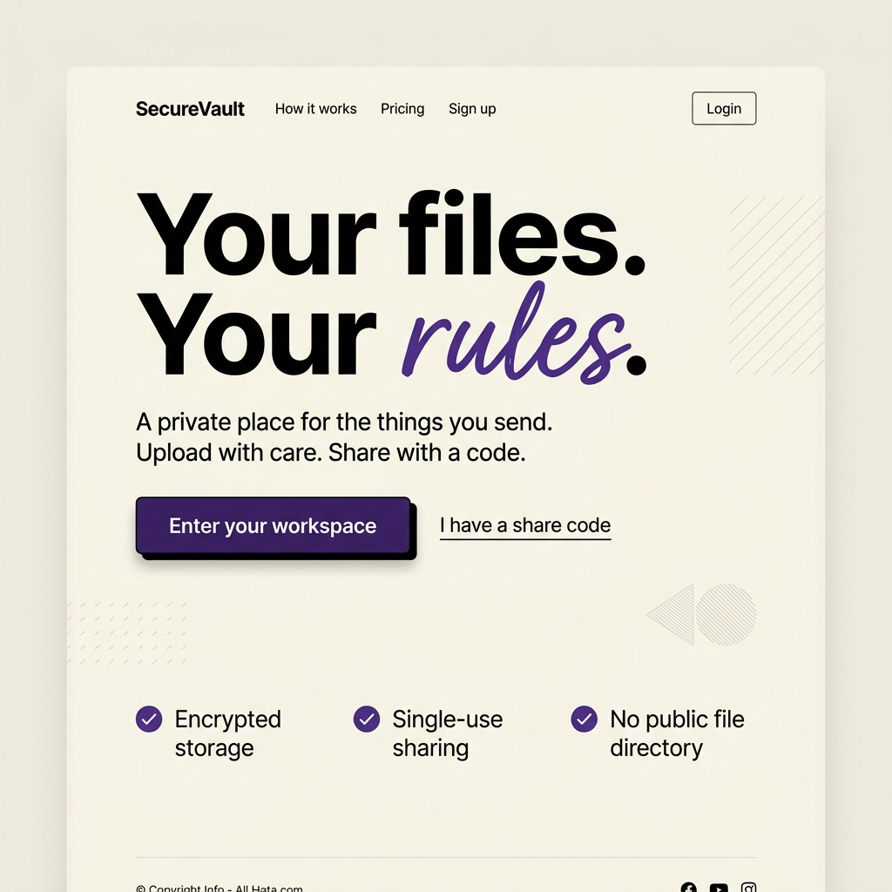
</p>

---

## Quick Start

### Prerequisites

| Requirement | Version | Purpose |
|:---|:---|:---|
| Python | 3.12+ | Runtime |
| pip | Latest | Package management |
| Git | 2.x | Version control |
| Docker *(optional)* | Latest | Container deployment |
| ClamAV *(optional)* | 1.x | Antivirus scanning |

### Windows (PowerShell)

```powershell
# Clone the repository
git clone https://github.com/abhishekk-y/Secure-File-Upload-System.git
cd Secure-File-Upload-System

# Create virtual environment and install dependencies
py -3.12 -m venv .venv
.\.venv\Scripts\python.exe -m pip install -r requirements.txt

# Launch the server
.\.venv\Scripts\python.exe run.py
```

### Linux / macOS

```bash
# Clone and setup
git clone https://github.com/abhishekk-y/Secure-File-Upload-System.git
cd Secure-File-Upload-System

python3 -m venv .venv
.venv/bin/python -m pip install -r requirements.txt
.venv/bin/python run.py
```

### Docker

```bash
docker compose up --build -d     # Start
docker compose logs -f           # View logs
docker compose down              # Stop (data preserved)
```

> **Warning**: Do not run `docker compose down -v` unless you intend to destroy all data including encryption keys.

Visit **http://127.0.0.1:5000**, create an account (passwords must be 12-128 characters), and start uploading.

---

## Security Pipeline

Every file uploaded to SecureVault passes through a rigorous multi-stage validation and processing pipeline before it reaches encrypted storage.

<p align="center">
  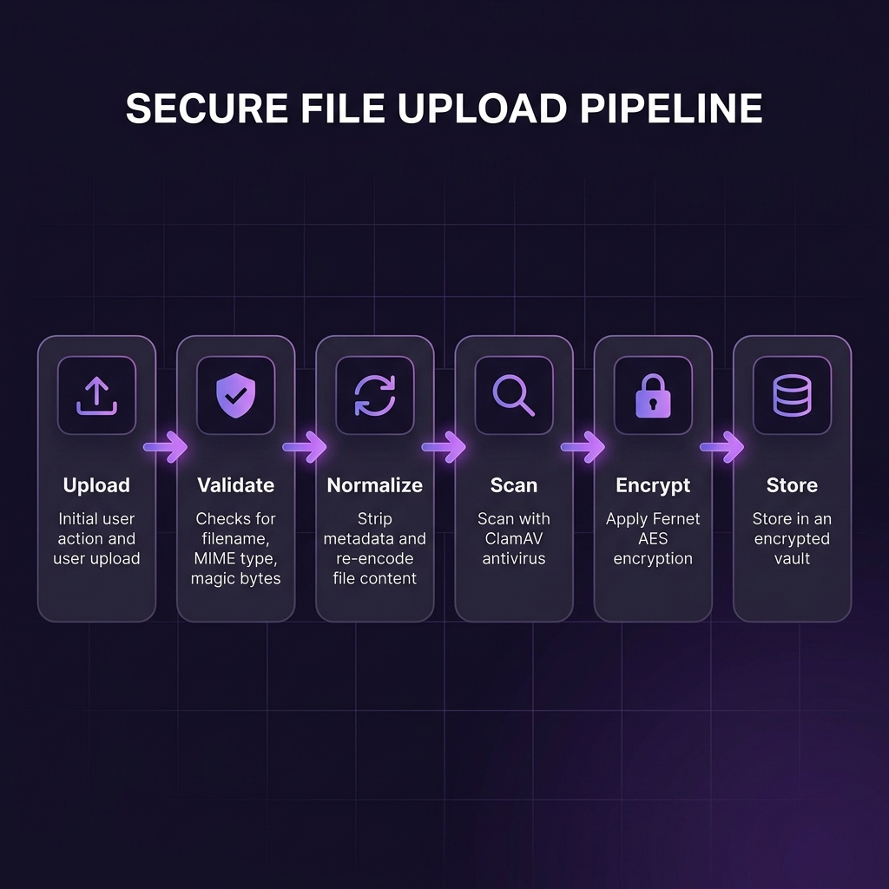
</p>

### The 12-Step Upload Pipeline

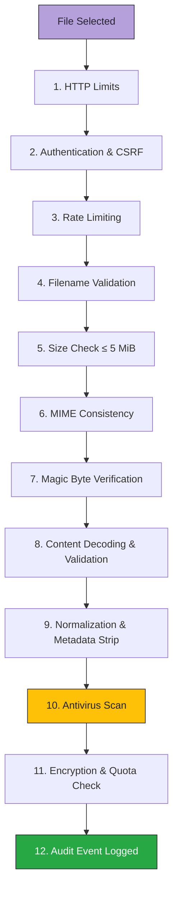

### Validation Details

| Step | Check | Action on Failure |
|:---:|:---|:---|
| 1 | HTTP request and multipart field/part limits | Request rejected (413) |
| 2 | Valid session + CSRF token | Redirect to login / 403 |
| 3 | Per-IP rate limits (20 uploads/min) | 429 Too Many Requests |
| 4 | Filename: alphanumeric, single extension, `≤ 96` chars | Upload rejected with explanation |
| 5 | File size: non-empty, `≤ 5 MiB` | Upload rejected |
| 6 | Declared MIME matches extension | Upload rejected |
| 7 | PNG: `89 50 4E 47 0D 0A 1A 0A` / JPEG: `FF D8 FF` | Upload rejected |
| 8 | Pillow full decode + format match + 16MP limit / UTF-8 validation | Upload rejected |
| 9 | Image re-encoded, EXIF/GPS/metadata cleared, trailing bytes removed | Original bytes discarded |
| 10 | ClamAV scan with 30s timeout (if configured) | Upload rejected |
| 11 | Fernet encryption, SHA-256 fingerprint, quota enforcement | Upload rejected / rolled back |
| 12 | HMAC-chained audit event appended | -- |

---

## Features

### File Security

<table>
<tr>
<td width="50%">

**Upload Validation**
- Allowlisted extensions: TXT, PNG, JPG, JPEG
- Strict filename character restrictions
- MIME type and magic byte cross-validation
- Full image decoding with Pillow verification
- Decompression bomb protection (16MP limit)
- UTF-8 and control character validation for text

</td>
<td width="50%">

**Normalization & Storage**
- Images re-encoded: metadata, EXIF, GPS stripped
- Trailing bytes and embedded content removed
- Fernet authenticated encryption (AES-128-CBC + HMAC-SHA-256)
- Random 128-bit storage identifiers
- SHA-256 plaintext integrity verification on download
- Per-user quotas: 50 MiB / 200 files

</td>
</tr>
</table>

### Authentication & Sessions

<table>
<tr>
<td width="50%">

**Password Security**
- Salted scrypt hashing (N=32768, r=8, p=3)
- Timing-leak resistant with dummy hash comparison
- 12-128 character password policy
- Per-IP login rate limiting (10/min)

</td>
<td width="50%">

**Session Management**
- Signed HttpOnly/SameSite cookies
- Server-side session records with 30-min absolute expiry
- Individual and all-device session revocation
- Session replacement on new login

</td>
</tr>
</table>

### Two-Factor Authentication (TOTP)

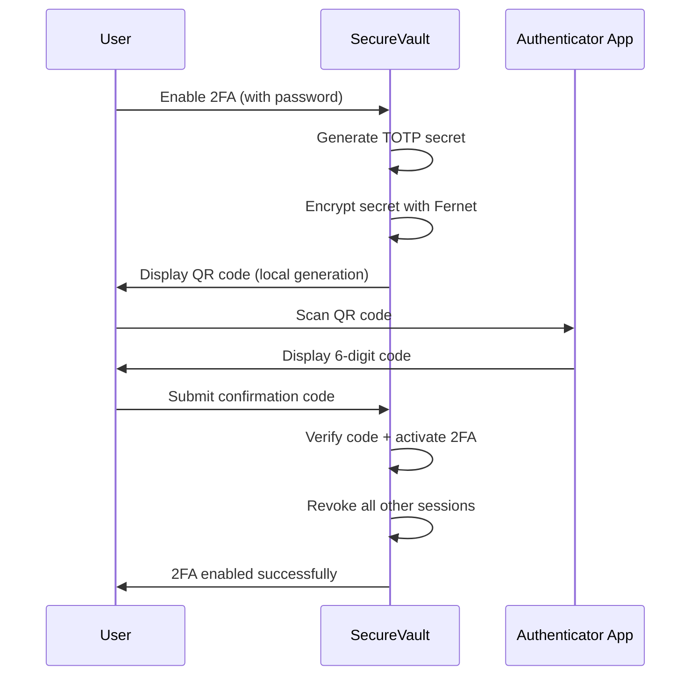

- TOTP enrollment requires current password confirmation
- QR codes generated locally (no external QR services)
- Replay prevention with atomic time-step tracking
- Adjacent 30-second window tolerance
- Encrypted secret storage (Fernet)

### Controlled File Sharing

<p align="center">
  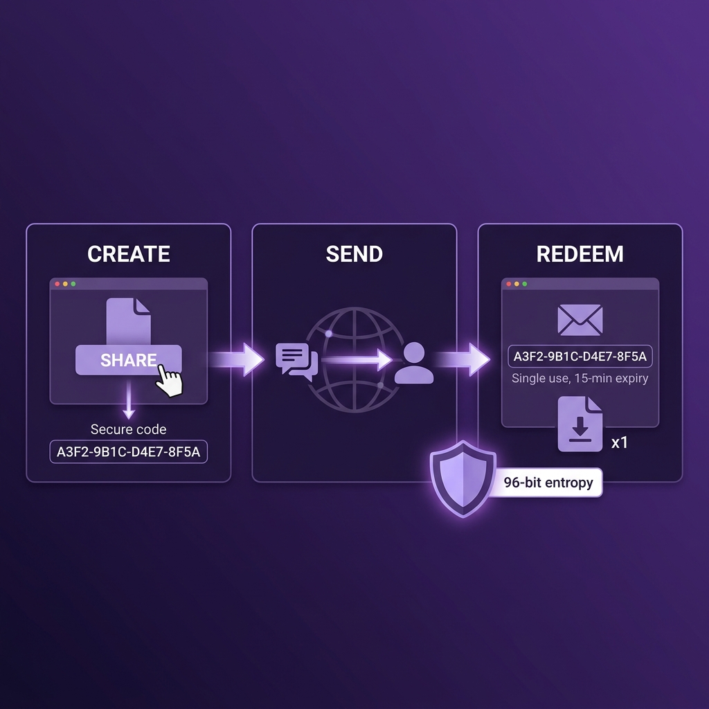
</p>

| Property | Implementation |
|:---|:---|
| **Code Format** | 24-character hex (96-bit entropy), formatted as `XXXX-XXXX-XXXX-XXXX-XXXX-XXXX` |
| **Storage** | Only SHA-256 hash stored; raw code never persisted |
| **Expiry** | 15 minutes from creation |
| **Usage** | Single-use with atomic compare-and-update redemption |
| **Concurrency** | Safe under simultaneous redemption attempts |
| **Revocation** | Owner can revoke at any time |
| **Limit** | Maximum 20 active codes per user |

### Tamper-Evident Audit Trail

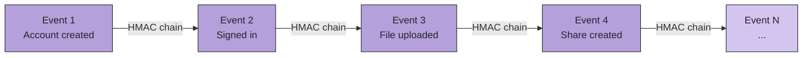

Each event is linked by `HMAC-SHA-256(audit_key, [previous_mac, id, user_id, action, detail, timestamp])`. Editing or deleting interior records breaks the chain and is detected on the activity page.

### Web Security Controls

| Control | Implementation |
|:---|:---|
| **CSRF** | Flask-WTF token on all state-changing routes |
| **SQL Injection** | Parameterized queries throughout |
| **XSS** | Auto-escaped Jinja2 templates |
| **CSP** | `default-src 'self'; object-src 'none'; frame-ancestors 'none'` |
| **Headers** | `X-Content-Type-Options: nosniff`, `X-Frame-Options: DENY`, `Referrer-Policy: no-referrer` |
| **HSTS** | Enabled when `APP_HTTPS=1` |
| **Cache** | `Cache-Control: no-store` on all responses |
| **Permissions** | Camera, microphone, geolocation disabled |

### OpenCV Document Scanner

Optional image processing for document photos at upload:

| Feature | Description |
|:---|:---|
| **Edge Detection** | Canny + morphological closing for page boundary detection |
| **Perspective Correction** | Four-corner detection with warp transformation |
| **Contrast Enhancement** | CLAHE (Contrast Limited Adaptive Histogram Equalization) |
| **Size Boundary** | Downsampled to max 2000px, minimum 64px sides |
| **Fallback** | Full-frame enhancement when no page boundary detected |

---

## Architecture

### System Overview

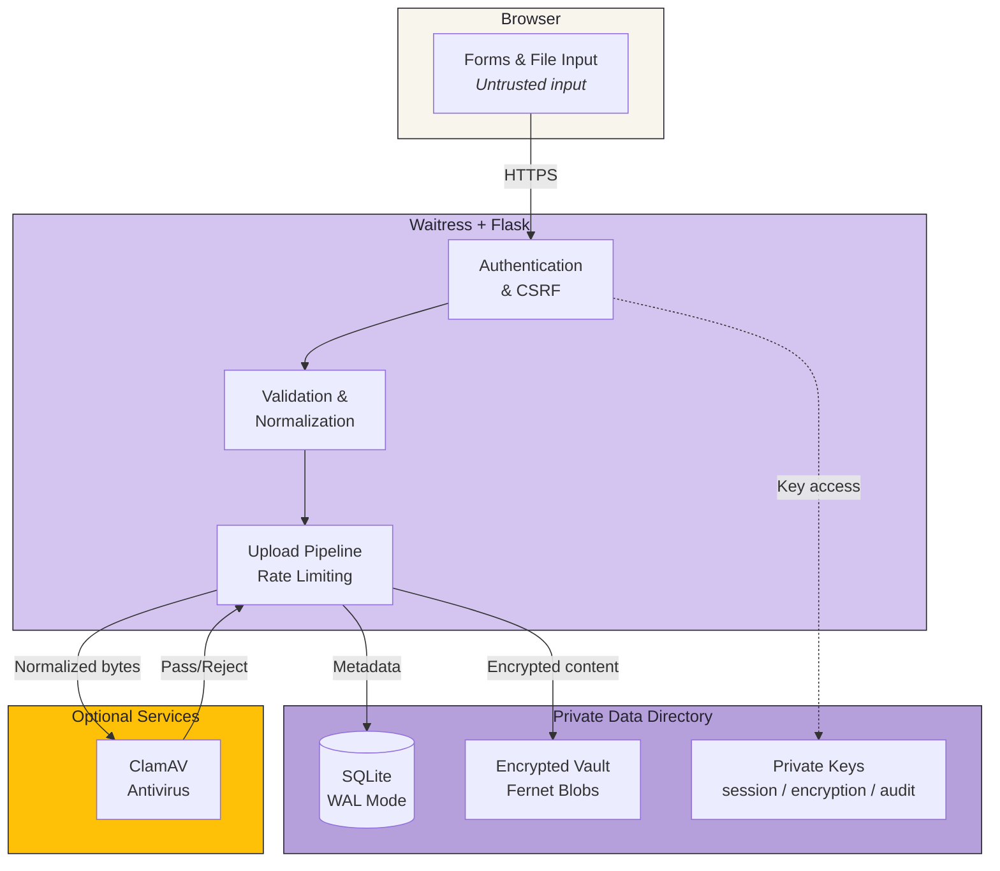

<p align="center">
  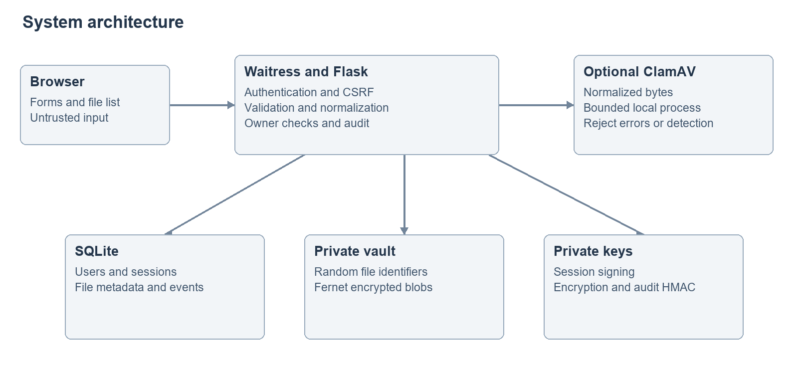
</p>

### Encryption Model

<p align="center">
  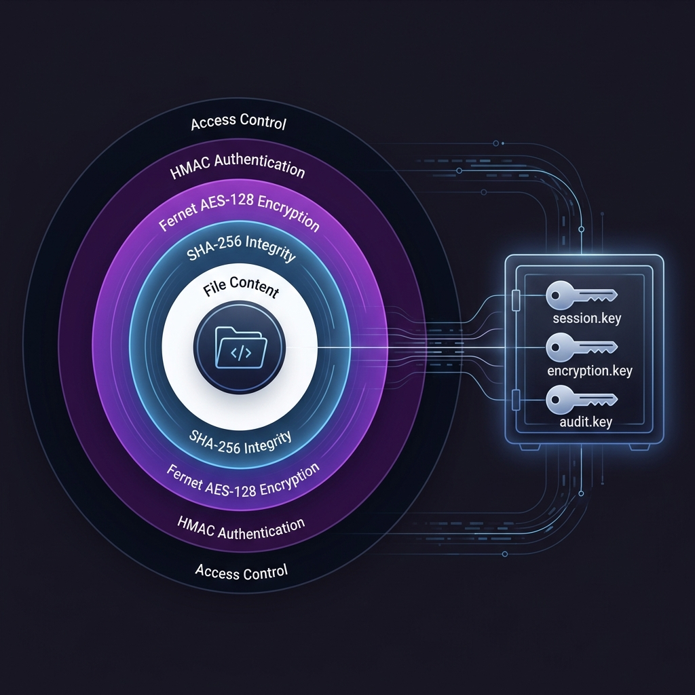
</p>

| Component | Algorithm | Purpose |
|:---|:---|:---|
| **Passwords** | scrypt (N=32768, r=8, p=3) | Memory-hard password hashing |
| **File Encryption** | Fernet (AES-128-CBC + HMAC-SHA-256) | Authenticated encryption at rest |
| **File Integrity** | SHA-256 | Plaintext fingerprint verified on download |
| **Session Signing** | HMAC-SHA-256 | Cookie integrity |
| **Audit Chain** | HMAC-SHA-256 | Tamper-evident event linking |
| **TOTP Secrets** | Fernet-encrypted storage | Encrypted authenticator secrets |

> **Important**: Fernet provides AES-128-CBC with HMAC-SHA-256 -- it is **not** AES-256 and **not** end-to-end encryption. The application server holds decryption keys.

### Database Schema

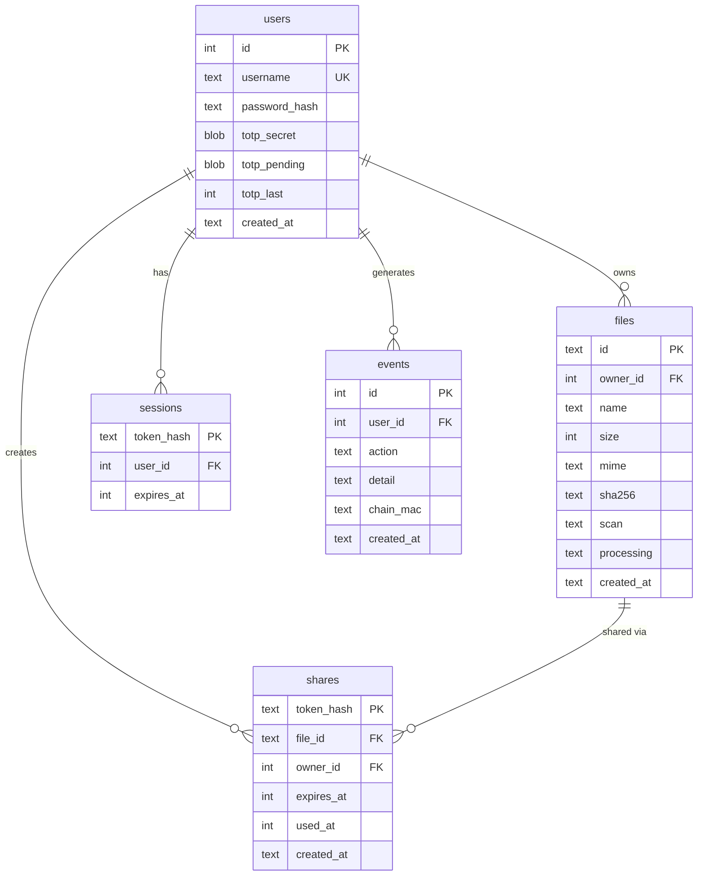

### Project Structure

```
SecureVault/
├── app/
│   ├── __init__.py                 # App factory, database, security pipeline, routes
│   ├── document_scanner.py         # OpenCV document processing
│   ├── static/
│   │   ├── design.css              # Neobrutalist design system
│   │   ├── app.js                  # Upload dialogs, progress, filtering, copy
│   │   └── mark.svg                # Application logo
│   └── templates/
│       ├── base.html               # Layout with CSRF, headers, navigation
│       ├── landing.html            # Editorial landing page
│       ├── auth.html               # Login / registration
│       ├── dashboard.html          # File vault with search, filters, quotas
│       ├── security.html           # 2FA setup and session management
│       ├── shares.html             # Active share code management
│       ├── share_created.html      # Generated share code display
│       ├── receive.html            # Public code redemption
│       ├── activity.html           # Tamper-evident audit trail
│       ├── icons.html              # Inline SVG icon macros
│       └── error.html              # Error pages (400-500)
├── tests/
│   ├── test_security.py            # Auth, upload, encryption, quota tests
│   ├── test_sharing.py             # Sharing, isolation, concurrency tests
│   └── test_document_scanner.py    # Document processing tests
├── docs/
│   ├── PROJECT_REPORT.md           # Complete academic report (SRS, SDLC)
│   ├── SYNOPSIS.md                 # Project synopsis
│   ├── SECURITY.md                 # Security model and limitations
│   ├── DIAGRAMS.md                 # Architecture and flow diagrams
│   ├── DEPLOYMENT.md               # Production deployment guide
│   ├── TESTING.md                  # Test plan and evidence
│   ├── RESEARCH.md                 # Literature review and references
│   └── DEMO_AND_VIVA.md            # Demonstration guide
├── scripts/
│   ├── build_documents.py          # Markdown to DOCX/PDF converter
│   ├── build_submission.py         # Academic submission packager
│   └── start.ps1                   # PowerShell launcher
├── .github/
│   ├── workflows/security.yml      # CI: tests, Bandit, dependency audit
│   └── dependabot.yml              # Automated dependency updates
├── Dockerfile                      # Container build
├── compose.yaml                    # Docker Compose with persistent volume
├── requirements.txt                # Production dependencies
├── requirements-dev.txt            # Development dependencies
└── run.py                          # Waitress production entry point
```

---

## Interface Preview

<p align="center">
  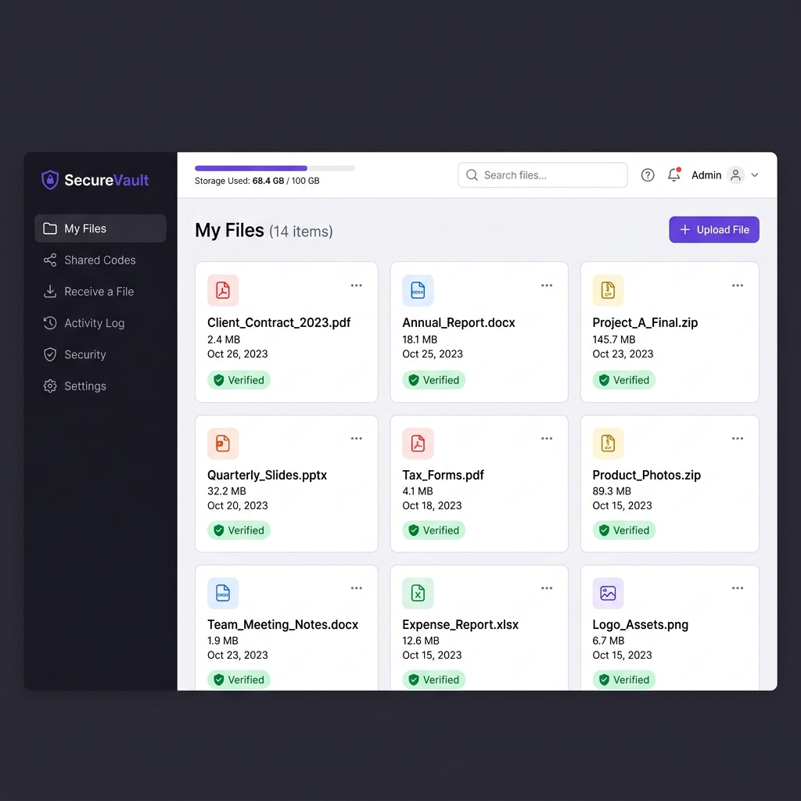
</p>

### Application Pages

| Page | Route | Description |
|:---|:---|:---|
| Landing | `/` | Public editorial homepage with security overview |
| Login / Register | `/login`, `/register` | Authentication with optional TOTP |
| Vault | `/vault` | File manager with search, type filters, storage overview |
| Upload | `/upload` | Drag-and-drop with progress, optional document scan |
| File Details | `/files/<id>/preview` | Image preview with security inspection |
| Inspection Report | `/files/<id>/inspection` | JSON security analysis report |
| Shared Codes | `/shares` | Active code management and revocation |
| Receive | `/receive` | Public code redemption for file download |
| Activity | `/activity` | HMAC-verified audit trail (latest 100 events) |
| Security | `/security` | 2FA enrollment and session management |

---

## Testing

### Run the Test Suite

```powershell
# Install test dependencies
.\.venv\Scripts\python.exe -m pip install -r requirements-dev.txt

# Run all tests with JUnit XML output
.\.venv\Scripts\python.exe -m pytest -q --junitxml=docs/test-results.xml
```

### Test Coverage

| Category | Tests | What is Verified |
|:---|:---:|:---|
| **Authentication** | 8 | Registration validation, login flow, password hashing, timing leaks |
| **Upload Security** | 12 | Filename rejection, MIME mismatch, magic bytes, oversized files, quota enforcement |
| **Encryption** | 4 | Fernet encrypt/decrypt, SHA-256 integrity, corruption detection |
| **Sessions** | 5 | Expiry, revocation, concurrent sessions, CSRF enforcement |
| **TOTP** | 4 | Enrollment, verification, replay prevention, disable flow |
| **Sharing** | 8 | Code generation, single-use, expiry, concurrent redemption, revocation |
| **Audit** | 4 | Chain creation, tamper detection, interior deletion detection |
| **Document Scanner** | 4 | Edge detection, perspective warp, CLAHE, fallback behavior |

**Latest recorded result**: 49 tests passed, 0 failures, 0 errors, 0 skipped.

### Security Scanning

| Tool | Purpose | Status |
|:---|:---|:---|
| **Bandit** | Python SAST analysis | Results in `docs/bandit-results.json` |
| **pip-audit** | Dependency vulnerability scan | Results in `docs/dependency-audit.json` |
| **GitHub Actions** | Automated CI on push/PR | Configured in `.github/workflows/` |
| **Dependabot** | Automated dependency updates | Configured in `.github/dependabot.yml` |

---

## Threat Model

| Threat | Mitigation | Residual Risk |
|:---|:---|:---|
| **Path traversal** | Strict basename, random internal IDs, owner-bound lookup | Host filesystem must remain trusted |
| **Executable disguise** | MIME + signature + full decoder + re-encoding | Parser vulnerabilities require dependency updates |
| **Decompression bomb** | 16MP pixel cap, Pillow bomb warnings as errors | Concurrent image processing uses memory |
| **Cross-account access** | Owner predicate on all file operations | Operator can read database and keys |
| **CSRF** | Flask-WTF tokens on all state-changing routes | XSS would compromise session |
| **SQL injection** | 100% parameterized queries | Dynamic migration uses fixed constants |
| **Password guessing** | scrypt + per-IP rate limiting | Distributed attacks need further work |
| **TOTP replay** | Atomic last-step update | TOTP is phishable (passkeys proposed) |
| **Blob corruption** | Fernet authentication + SHA-256 check | Missing files unrecoverable without backup |
| **Audit tampering** | Per-user HMAC chain | Tail truncation needs external checkpoints |
| **Storage exhaustion** | Per-user quotas (50 MiB / 200 files) | Global server disk needs monitoring |

---

## Configuration

### Environment Variables

| Variable | Default | Description |
|:---|:---|:---|
| `CLAMSCAN_PATH` | *(empty)* | Path to `clamscan` or `clamdscan` binary |
| `REQUIRE_SCAN` | `0` | Set to `1` to reject uploads when scanner is unavailable |
| `APP_HTTPS` | `0` | Set to `1` to enable Secure cookies and HSTS |
| `DATA_DIR` | `instance/` | Private data directory (database, keys, vault) |
| `RATELIMIT_STORAGE_URI` | `memory://` | Rate limiter backend (Redis for multi-process) |

### Private Data (`instance/`)

| File | Purpose | Recovery |
|:---|:---|:---|
| `vault.sqlite3` | User accounts, file metadata, events | Back up regularly |
| `encryption.key` | Fernet key for file and TOTP encryption | **Loss = unrecoverable data** |
| `session.key` | Flask session signing key | Loss = all sessions invalidated |
| `audit.key` | HMAC chain authentication key | Loss = chain verification fails |
| `vault/` | Encrypted file blobs | Must restore with matching encryption.key |

> **Critical**: Back up keys and data together. Never commit `instance/` to version control.

---

## Technology Stack

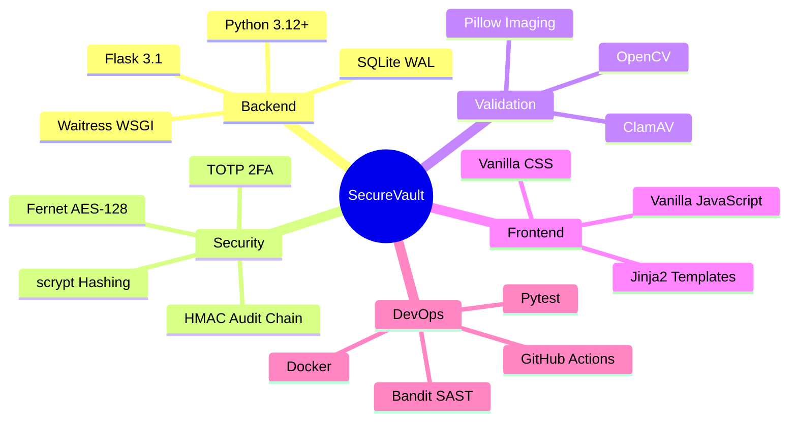

### Dependencies

| Package | Version | Purpose |
|:---|:---|:---|
| Flask | 3.1.3 | Web framework |
| Flask-WTF | 1.3.0 | CSRF protection |
| Flask-Limiter | 4.1.1 | Rate limiting |
| Waitress | 3.0.2 | Production WSGI server |
| Pillow | 12.3.0 | Image validation, decoding, re-encoding |
| cryptography | 50.0.1 | Fernet authenticated encryption |
| pyotp | 2.10.0 | TOTP 2FA implementation |
| qrcode | 8.2 | Local QR code generation |
| opencv-python-headless | 4.14.0.94 | Document scanning and processing |

---

## Future Roadmap

The following features are planned for future development phases. They represent extension proposals that build on the existing security architecture.

### Phase 2: Advanced Security Engines

| Engine | Description | Status |
|:---|:---|:---:|
| **Deep CDR** | Content Disarm and Reconstruction for PDF, DOCX, SVG, HTML, XML, CSV | Planned |
| **Multi-Engine Scanner** | YARA rules + heuristic analysis alongside ClamAV | Planned |
| **DLP Scanner** | Detect credit cards, SSNs, API keys in uploaded content | Planned |
| **Vulnerability Assessment** | Check files for known CVE patterns and exploit vectors | Planned |
| **Threat Intelligence** | Local hash reputation database with upload tracking | Planned |
| **Sandbox Analysis** | Static behavioral analysis for auto-execution triggers | Planned |

### Phase 3: Extended File Support

| Format | CDR Strategy |
|:---|:---|
| **PDF** | Strip JavaScript, embedded files, launch actions, auto-open triggers |
| **DOCX** | Remove VBA macros, external references, OLE objects |
| **SVG** | Strip `<script>`, event handlers, external references |
| **HTML** | Sanitize tags, remove scripts, iframes, event handlers |
| **XML** | Remove DTD declarations, external entity references (XXE prevention) |
| **CSV** | Validate structure, check for formula injection |

### Phase 4: Infrastructure

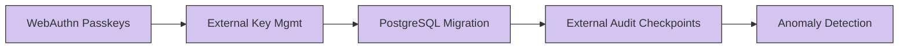

| Feature | Description |
|:---|:---|
| **WebAuthn Passkeys** | Origin-bound public-key credentials replacing TOTP |
| **Asynchronous Quarantine** | Pending/scanning/accepted/rejected file state machine |
| **External Key Management** | Per-file data keys wrapped by KMS with rotation support |
| **External Audit Checkpoints** | Append-only external store for chain-head verification |
| **Anomaly Detection** | Rule-based upload rejection and login failure analysis |
| **PostgreSQL** | Migration from SQLite for multi-instance deployments |

---

## Research References

| ID | Source | Project Connection |
|:---:|:---|:---|
| R1 | [OWASP File Upload Cheat Sheet](https://cheatsheetseries.owasp.org/cheatsheets/File_Upload_Cheat_Sheet.html) | Layered validation, private storage, bounded uploads |
| R2 | [OWASP Password Storage](https://cheatsheetseries.owasp.org/cheatsheets/Password_Storage_Cheat_Sheet.html) | Memory-hard scrypt parameters |
| R3 | [NIST SP 800-218 SSDF](https://csrc.nist.gov/pubs/sp/800/218/final) | Security in SDLC phases |
| R4 | [Fernet Specification](https://cryptography.io/en/stable/fernet/) | Authenticated encryption, key protection |
| R5 | [PyOTP Documentation](https://pyauth.github.io/pyotp/) | TOTP enrollment, replay prevention |
| R6 | [Flask Security](https://flask.palletsprojects.com/en/stable/web-security/) | CSRF, cookies, request limits |
| R7 | [Pillow Image Reference](https://pillow.readthedocs.io/en/stable/reference/Image.html) | Image verification, format detection |
| R8 | [ClamAV Documentation](https://docs.clamav.net/manual/Usage/Scanning.html) | Local scanner integration |
| R9 | [OPSWAT MetaDefender](https://www.opswat.com/products/metadefender) | Multi-engine scanning architecture inspiration |
| R10 | [OWASP Cryptographic Storage](https://cheatsheetseries.owasp.org/cheatsheets/Cryptographic_Storage_Cheat_Sheet.html) | Key-boundary and host-compromise discussion |

---

## Documentation

| Document | Description |
|:---|:---|
| [Project Report](docs/PROJECT_REPORT.md) | Complete academic report with SRS, SDLC, and analysis |
| [Synopsis](docs/SYNOPSIS.md) | Project synopsis with objectives and methodology |
| [Security Model](docs/SECURITY.md) | Threat model, trust boundaries, and honest limitations |
| [Architecture Diagrams](docs/DIAGRAMS.md) | System, sequence, and database diagrams |
| [Deployment Guide](docs/DEPLOYMENT.md) | Production deployment, HTTPS, backup, and monitoring |
| [Testing Evidence](docs/TESTING.md) | Test plan, methodology, and recorded results |
| [Research Sources](docs/RESEARCH.md) | Literature review with primary references |
| [Demo & Viva Guide](docs/DEMO_AND_VIVA.md) | Comprehensive demonstration walkthrough |

---

## Security Limitations

This is a tested academic application, not a certification of security:

- Antivirus scanning is **not installed or enabled by default**
- PDF, Office, SVG, archives, and executables are **intentionally unsupported** in the current version
- The server holds encryption keys; this is **not end-to-end encryption**
- Audit chain tail truncation requires external checkpoints to detect
- TOTP is susceptible to real-time phishing; passkeys are a planned replacement
- No formal penetration test or compliance assessment has been performed
- Rate limiting uses in-memory storage and resets on restart

See the full [security model and limitations](docs/SECURITY.md) for detailed analysis.

---

<p align="center">
  
  <br/>
  <strong>SecureVault</strong> -- A private workspace. Deliberate sharing.
  <br/>
  <sub>Cybersecurity Academic Project</sub>
</p>
