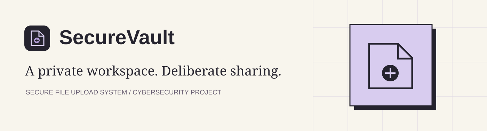
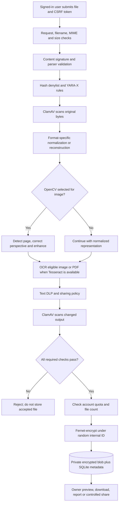
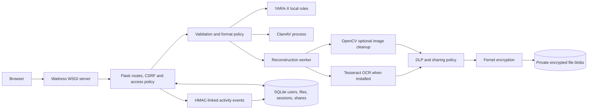
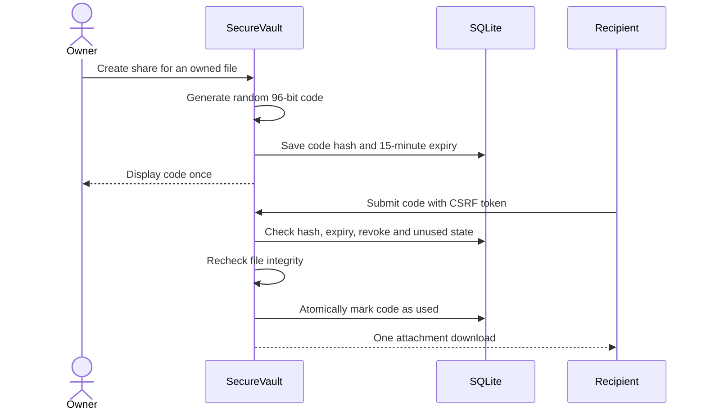
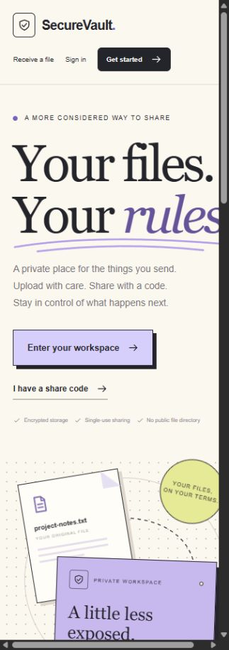
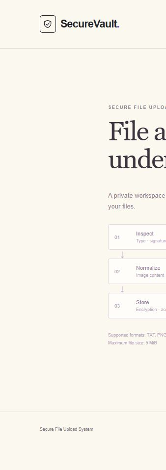
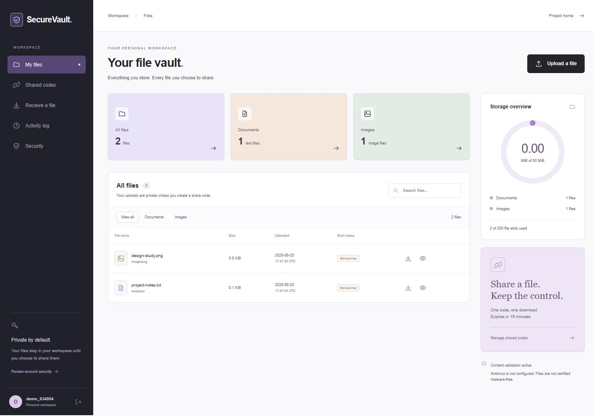
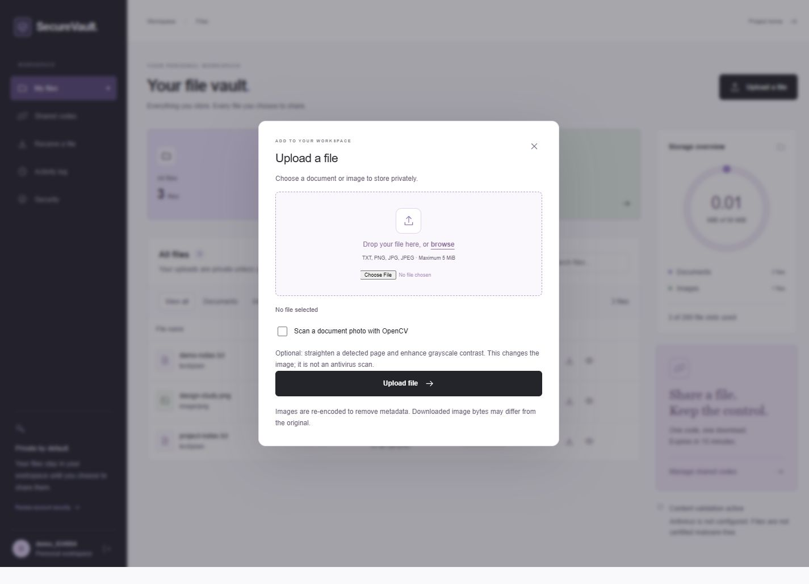
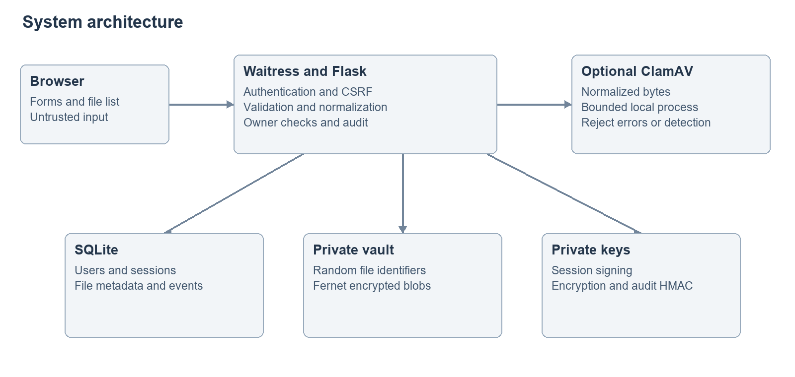

<p align="center">
  
</p>

<div align="center">

# SecureVault

### Inspect first. Store privately. Share deliberately.

<a href="https://github.com/abhishekk-y/Secure-File-Upload-System/actions/workflows/security.yml"></a>


[Overview](#overview) · [Features](#implemented-capabilities) · [Workflow](#how-an-upload-is-processed) · [Quick start](#run-locally) · [Architecture](#architecture) · [Documentation](#project-documents)

</div>

SecureVault is an academic cybersecurity application for safely receiving, inspecting, transforming and storing user files. It combines server-side validation, local security checks, reduced-feature document reconstruction, encrypted storage and owner-controlled sharing in one explainable workflow.

> **Project boundary:** SecureVault is a learning and demonstration system, not a security certification. It does not include commercial Deep CDR, multiple commercial antivirus engines or dynamic malware sandboxing. A “no match” result is not proof that a file is harmless.

## Overview

Ordinary upload forms often trust a filename or browser-provided content type. SecureVault treats both as untrusted claims. It checks the actual content, applies limits, runs the configured local inspection layers, and stores an encrypted representation only after the applicable policy passes.

| At a glance | Current behavior |
| --- | --- |
| Per-file upload limit | 50 MiB |
| Per-account storage quota | 500,000,000 bytes (500 MB decimal) |
| Per-account file count | 200 files |
| Self-service account cap | 5 accounts by default; configurable |
| Accepted file families | TXT, PNG, JPEG, PDF, DOCX, CSV, HTML, XML and restricted SVG |
| Antivirus policy | ClamAV is required by default; missing or failed scanning rejects an upload |
| OCR policy | Local Tesseract for PNG/JPEG and rendered PDF pages when installed |
| Sharing | Random 96-bit code, 15-minute expiry, one successful redemption, owner revocation |
| Storage | Encrypted file blobs in a private directory; SQLite stores account and file metadata |

## Implemented capabilities

| Capability | What SecureVault does | Evidence or limitation |
| --- | --- | --- |
| Account security | scrypt password hashes, CSRF protection, rate limits, server-checked sessions and optional TOTP MFA | No default accounts; no password recovery flow |
| Upload validation | Checks safe filename, extension, declared MIME, signatures where defined, parser structure and size | Plain text has no universal magic signature; it is validated as UTF-8 text |
| Transfer and inspection progress | Shows actual browser transfer percentage and server-reported inspection-stage checkpoints, with a timeout-based duration estimate | A long-running scan can pause the stage bar; antivirus engines do not expose live progress here |
| Image cleanup | Decodes and re-encodes PNG/JPEG to remove embedded metadata; optional OpenCV page detection and perspective correction | OpenCV is an image-cleanup feature, not OCR or malware detection |
| Document reconstruction | Rebuilds supported document formats into reduced-feature output | Some original formatting, metadata and interactive content are intentionally lost |
| Antivirus | Invokes local ClamAV for original and changed content with a timeout | One engine only; scanner errors fail closed |
| Local YARA-X | Compiles reviewed local rules and checks original upload bytes | Small local ruleset; complements antivirus and is not a full malware database |
| OCR-assisted DLP | Uses local Tesseract text from images/PDF pages in existing text checks | OCR can miss or misread text; the local check covered one synthetic English page |
| Sensitive-data policy | Rejects likely credential findings and blocks sharing for selected sensitive-data findings | Pattern checks are limited and cannot identify every sensitive value |
| Local hash policy | Operator-managed SHA-256 denylist can flag known blocked files | An unmatched hash does not mean globally trusted or malware-free |
| Private file storage | Random internal file IDs, Fernet authenticated encryption and SHA-256 integrity verification | Server-side encryption at rest, not end-to-end encryption |
| Inspection report | Owner-only web and JSON report records processing and security outcomes | Reports describe checks performed; they are not certificates |
| Controlled sharing | Stores a code hash, checks expiry/revocation and atomically consumes a valid code | Anyone holding the code can redeem it once before expiry |
| Activity integrity | Per-account HMAC-linked event history | Detects edits/interior deletion; an external checkpoint is needed to detect a removed final suffix |

## Future scope — not part of the current implementation

| Candidate improvement | Why it is useful | Current boundary |
| --- | --- | --- |
| Isolated parser worker | Reduce the effect of parser compromise with OS/container limits, restricted filesystem access and no network | Current subprocess has timeouts and size limits; it is not a hardened sandbox |
| External audit checkpoint | Detect deletion of the final part of the local HMAC chain | Current chain only verifies records that remain in SQLite |
| SBOM and dependency scanning in CI | Track the application’s software supply chain with Syft/Grype | This would scan SecureVault’s dependencies, not uploaded user files |
| OpenTelemetry metrics | Observe processing time and failures without recording filenames or file contents | No tracing exporter or monitoring backend is configured |
| Stronger account recovery | Add recovery codes and phishing-resistant passkeys | Optional TOTP is the only second factor currently implemented |
| Expanded DLP review | Add language-aware OCR and carefully validated policy patterns | Current checks are local, pattern-based and can miss data |

## Supported file formats

The system stores the accepted normalized representation. Keep an original copy if you need original metadata, formatting or signatures.

| Input | Processing and stored representation | Important behavior |
| --- | --- | --- |
| `.txt` | UTF-8 validation and bounded text checks | Disallowed binary control characters are rejected |
| `.png`, `.jpg`, `.jpeg` | Decode, normalize and re-encode; optional OpenCV scan | Image metadata is removed; animation is flattened to the decoded frame |
| `.pdf` | Render and rebuild up to 10 pages as an image-only PDF | Searchable text, digital signatures, links, forms, attachments and original metadata are not retained |
| `.docx` | Rebuild as plain paragraphs | Formatting, images, macros, fields, relationships and embedded objects are discarded |
| `.csv` | Parse and rewrite rows; prefix formula-like cells with an apostrophe | Spreadsheet import behavior can still vary by application |
| `.html`, `.htm` | Sanitize and rebuild a limited formatting allowlist | Active elements, scripts, links and external resources are removed; delivered as an attachment |
| `.xml` | Parse without DTD/entity expansion and emit a reduced structure | Attributes, processing instructions and XInclude are removed |
| `.svg` | Restrict to basic shapes and text | Scripts, links, filters and external resources are removed; download only |

Generic archives, legacy Office binaries, executables and arbitrary extensions are rejected. File size, image dimensions, PDF page count, archive expansion, parser output and processing time are bounded.

## How an upload is processed



The scanner, OCR, YARA-X, validation and DLP results are separate report fields. If a required scanner is absent or fails, the upload is rejected. A missing OCR engine is shown as unavailable; eligible image/PDF files cannot be shared when required OCR checks did not complete.

## Architecture



The reconstruction worker is a separate process with deadlines and bounded inputs. It is **not** an operating-system sandbox: PDFium OCR rendering occurs in the application process. File parsers and OCR are local; user file contents are not sent to a commercial scanning API.

## Technology stack

| Layer | Technology | Role in this project |
| --- | --- | --- |
| Runtime and web framework | Python 3.12, Flask 3.1 | Application routes, request policy and server-rendered pages |
| WSGI server | Waitress | Serves the Flask application process |
| Interface | Jinja, HTML, CSS and JavaScript | Responsive landing page, vault, upload interactions and reports |
| Metadata database | SQLite | Accounts, sessions, file metadata, shares and activity records |
| Image processing | Pillow and OpenCV | Image parsing/normalization and optional document-photo correction |
| Document processing | PDFium, `defusedxml`, `nh3` | Bounded PDF rendering, safe XML parsing and HTML sanitization |
| Authentication | Werkzeug scrypt, Flask-WTF, Flask-Limiter, PyOTP | Password verification, CSRF, rate limits and optional TOTP |
| File protection | `cryptography` Fernet, SHA-256, HMAC-SHA-256 | Encrypted blobs, integrity checks and authenticated event chaining |
| Detection | ClamAV, YARA-X, local SHA-256 denylist | Local antivirus, rule-based indicators and operator-managed blocks |
| OCR | Native Tesseract executable | Local OCR text for DLP on eligible images and PDFs |
| Quality checks | pytest, Bandit, pip-audit, GitHub Actions | Regression checks, static analysis and dependency review |

## Run locally

Use Python 3.12. Windows PowerShell:

```powershell
py -3.12 -m venv .venv
.\.venv\Scripts\python.exe -m pip install -r requirements.txt
.\.venv\Scripts\python.exe run.py
```

Linux or macOS:

```bash
python3 -m venv .venv
.venv/bin/python -m pip install -r requirements.txt
.venv/bin/python run.py
```

Open `http://127.0.0.1:5000`, create an account and use a synthetic file from `samples/`. There are no seeded production credentials. The app creates local keys and data under its private `instance/` directory; never add that directory or `.env` to Git.

### Local inspection engines

ClamAV and Tesseract are native programs installed separately from Python packages. The repository includes `scripts/setup_clamav.ps1` for the Windows ClamAV demonstration setup. Check ClamAV's signature database and the per-file report; a configured binary alone does not prove a successful scan. ClamAV is required by default, so an absent or failing scanner blocks uploads.

On Windows, run `scripts/setup_tesseract_local.ps1` to download the pinned Tesseract 5.5.3 release and English model into the ignored `.runtime/tesseract` directory. The script uses an installed 7-Zip command-line extractor, verifies both SHA-256 hashes, and does not modify system PATH or require Docker. The app auto-detects this project-local copy. For other systems, install Tesseract and English data using the [Tesseract project's installation guidance](https://github.com/UB-Mannheim/tesseract/wiki). `TESSERACT_CMD` can override executable discovery and `OCR_LANGUAGE` defaults to `eng`. OCR output is transient and is not saved in the report.

### Run checks

```powershell
.\.venv\Scripts\python.exe -m pip install -r requirements-dev.txt
.\.venv\Scripts\python.exe -m pytest -q
```

The CI workflow also runs Bandit and pip-audit. The latest local regression run completed **94 tests with no failures in 78.66 seconds**. A native Tesseract 5.5.3 check recognized the synthetic OCR sample and the DLP policy blocked it without storing the matched value. The recorded security review had no medium or high Bandit findings; low findings are documented in [TESTING.md](docs/TESTING.md). A passing test suite is evidence for the cases tested, not proof that no vulnerabilities exist.

## Account and security model



| Control | Design choice | Boundary to explain |
| --- | --- | --- |
| Password storage | Salted scrypt, `N=32768, r=8, p=3` | Password reset and identity recovery are not implemented |
| Session lifecycle | Random server-side session token hash; 30-minute expiry; logout revocation | Secure-cookie setting depends on the local HTTPS configuration |
| MFA | Optional TOTP; accepted time step is stored to reject replay | TOTP can still be phished; recovery codes are not implemented |
| File storage | Fernet encryption, random storage ID and SHA-256 integrity check | The server owns the key, so encryption is not end-to-end |
| Authorization | Owner ID checked on each file operation | Random IDs do not replace authorization checks |
| Audit history | HMAC chain per user | Final-suffix deletion needs an independent checkpoint to detect |
| Resource limits | 50 MiB/file, image/PDF/parser bounds, account quota and count cap | Host disk capacity and broad availability remain operator concerns |

## Requirements and SDLC

SecureVault follows an iterative secure software development life cycle. Security requirements and misuse cases inform design and implementation; regression evidence is reviewed at each change.

| SDLC phase | Project activity | Reviewable output |
| --- | --- | --- |
| Planning | Define the upload threat, users, academic goals and scope boundaries | [Synopsis](docs/SYNOPSIS.md) |
| Requirements | Specify functional behavior, security requirements and acceptance checks | Synopsis requirements and feature matrix |
| Analysis and design | Model trust boundaries, file lifecycle, storage entities and misuse cases | [Architecture diagrams](docs/DIAGRAMS.md), [security model](docs/SECURITY.md) |
| Implementation | Build account, upload, detection, storage, sharing and interface modules | `app/`, `scripts/`, `samples/` |
| Verification | Exercise valid/invalid paths, authorization, integrity, parser limits and share races | `tests/`, [test record](docs/TESTING.md), CI workflow |
| Maintenance | Review dependencies, rules, scanner signatures and documented limitations | Dependency and security review notes |

## Screenshots

These are interface captures from the project workspace; use a live local run for the current processing status and feature demonstration.

| Landing page | Sign in | Vault |
| --- | --- | --- |
|  |  |  |

| Upload interaction | Architecture illustration |
| --- | --- |
|  |  |

## Project structure

```text
SecureVault/
├── app/
│   ├── __init__.py              Flask app factory, routes, sessions, storage and sharing
│   ├── content_worker.py        Bounded document reconstruction worker
│   ├── document_scanner.py      OpenCV page detection and image cleanup
│   ├── security_engines.py      YARA-X, OCR adapter, DLP and hash policy
│   ├── rules/                   Local YARA-X signatures
│   ├── static/                  Styles, browser behavior and original SVG mark
│   └── templates/               Server-rendered pages and inspection report
├── docs/
│   ├── figures/                 Original architecture, workflow and product diagrams
│   ├── screenshots/             UI reference screenshots
│   ├── DIAGRAMS.md              Editable Mermaid design diagrams
│   ├── DEMO_AND_VIVA.md         Demonstration script and viva questions
│   ├── RESEARCH.md              Research sources and comparison
│   ├── SECURITY.md              Threat model and implementation boundaries
│   ├── SYNOPSIS.md              Editable academic synopsis
│   └── TESTING.md               Test evidence and verification limits
├── samples/                     Synthetic demonstration files only
├── scripts/                     Local startup, ClamAV, hash and document utilities
├── tests/                       Security, sharing, format and scanner tests
├── .github/workflows/           Automated test and security checks
├── .env.example                 Configuration reference (not loaded automatically)
├── AI_README.md                 Project context for a future coding session
├── requirements.txt             Runtime dependency pins
├── requirements-dev.txt         Test dependency pins
└── run.py                       Waitress local application entry point
```

`instance/`, `.runtime/`, `.venv/`, `.clamav/`, `.env` and personal documents are local-only and must not be committed.

## Safe demonstration

1. Register a local account and upload `samples/demo-notes.txt`.
2. Open the file’s inspection report and explain which results actually ran.
3. Upload `samples/document-photo.png` with the OpenCV option and compare the normalized result with your original.
4. Upload a supported document sample and describe the reconstruction trade-offs.
5. Use `samples/yara-demo-powershell.txt` to show a harmless text signature match. It contains inert text, not executable malware.
6. Use `samples/ocr-demo.png` to demonstrate OCR-assisted DLP. On Windows, first run `scripts/setup_tesseract_local.ps1`; on systems without the native engine, explain the unavailable state.
7. Create a share code for an eligible file, redeem once, and explain why reuse fails.
8. Explain the limits: one antivirus engine, local rules, pattern-based DLP, server-held keys and no dynamic sandbox.

Use only synthetic files. Never demonstrate with real credentials, personal documents or live malware.

## Project documents

| Material | Location |
| --- | --- |
| Academic synopsis | [PDF](docs/SYNOPSIS.pdf) · [Word](docs/SYNOPSIS.docx) · [editable Markdown](docs/SYNOPSIS.md) |
| Presentation | [PowerPoint](docs/PRESENTATION.pptx) · [PDF](docs/PRESENTATION.pdf) · [speaker notes](docs/PRESENTATION_NOTES.md) |
| Architecture and data-flow diagrams | [Mermaid source](docs/DIAGRAMS.md) · [figure gallery](docs/figures/) |
| Security design and limitations | [SECURITY.md](docs/SECURITY.md) |
| Research foundation | [RESEARCH.md](docs/RESEARCH.md) |
| Test plan and evidence | [TESTING.md](docs/TESTING.md) · [JUnit XML](docs/test-results.xml) |
| Detailed project report | [PDF](docs/PROJECT_REPORT.pdf) · [Word](docs/PROJECT_REPORT.docx) · [editable Markdown](docs/PROJECT_REPORT.md) |
| Practical demonstration and viva | [DEMO_AND_VIVA.md](docs/DEMO_AND_VIVA.md) |

Replace academic placeholders with genuine student, institution and guide details before submission.

## Research references

- OWASP, [File Upload Cheat Sheet](https://cheatsheetseries.owasp.org/cheatsheets/File_Upload_Cheat_Sheet.html)
- OWASP, [Password Storage Cheat Sheet](https://cheatsheetseries.owasp.org/cheatsheets/Password_Storage_Cheat_Sheet.html)
- NIST, [SP 800-218 Secure Software Development Framework](https://csrc.nist.gov/pubs/sp/800/218/final)
- Python Cryptographic Authority, [Fernet documentation](https://cryptography.io/en/stable/fernet/)
- YARA-X, [Python API documentation](https://virustotal.github.io/yara-x/docs/api/python/)
- Tesseract, [documentation and installation](https://tesseract-ocr.github.io/tessdoc/)

See [RESEARCH.md](docs/RESEARCH.md) for the project’s source notes and how each reference relates to implementation choices.
