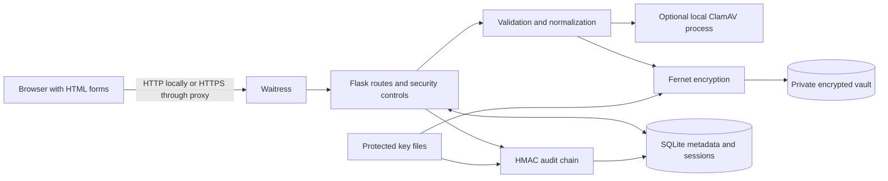
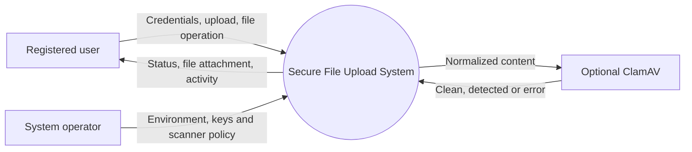
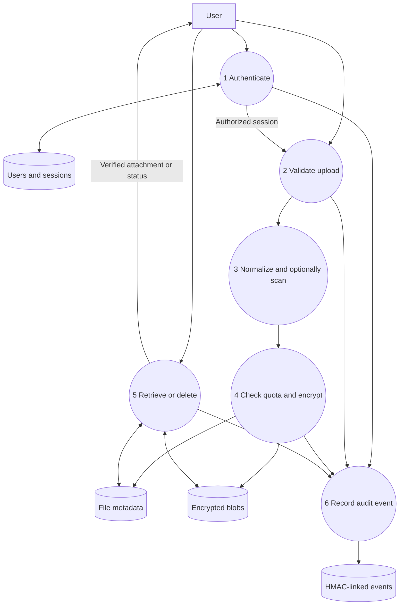
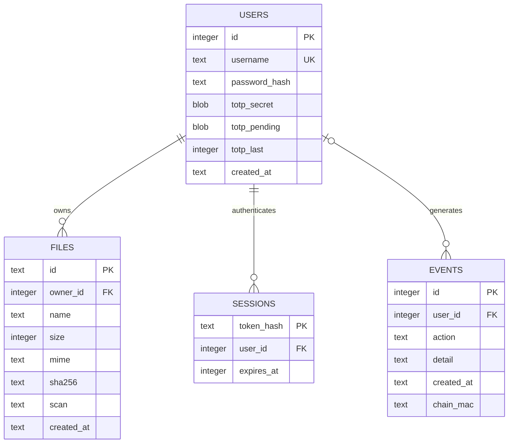
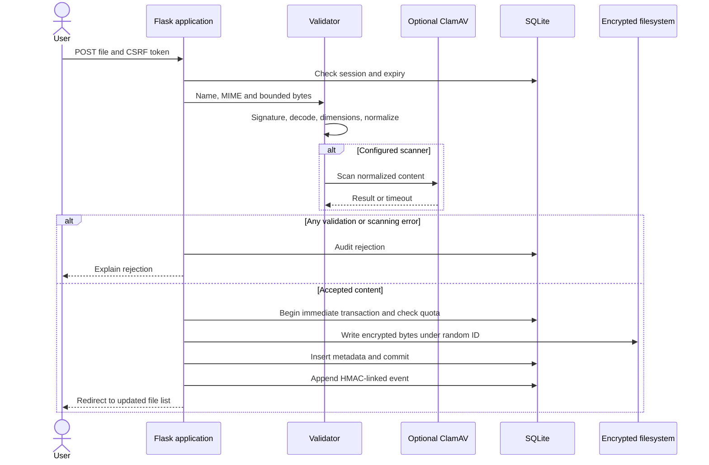
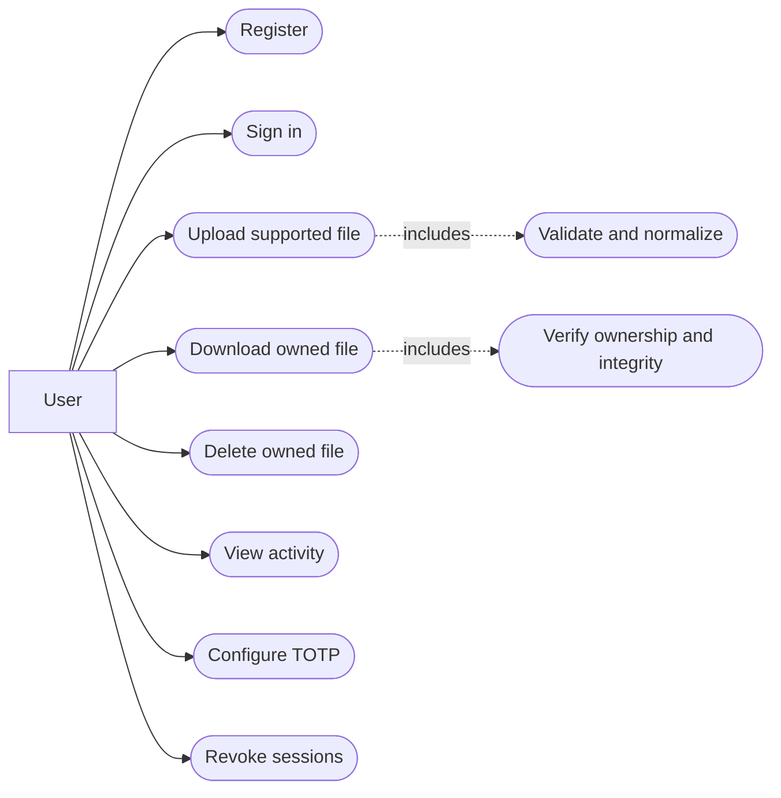
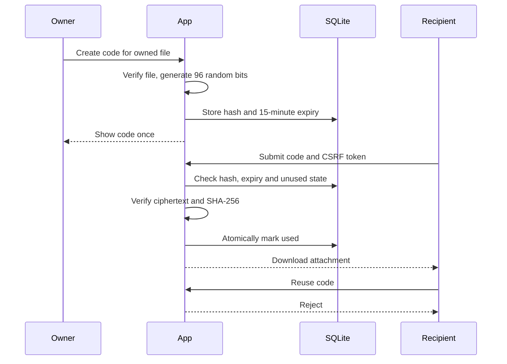
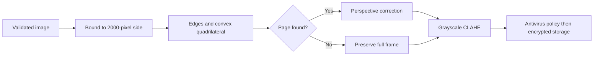

# System diagrams

These Mermaid diagrams are editable design sources. GitHub renders Mermaid blocks directly. The Word report also includes generated architecture, upload-flow and database figures.

## System architecture

## Context DFD

## Level 1 DFD

## Entity relationship diagram

## Upload sequence

## Use cases

## File life cycle

```mermaid
stateDiagram-v2
    [*] --> Received
    Received --> Rejected: Invalid request or content
    Received --> Normalized: Valid content
    Normalized --> Rejected: Scanner or quota failure
    Normalized --> Stored: Encrypt and commit
    Stored --> Stored: Authorized verified download
    Stored --> Unavailable: Integrity check fails
    Stored --> Deleted: Authorized POST deletion
    Rejected --> [*]
    Deleted --> [*]
```

The life-cycle states describe control flow; they are not a persistent quarantine state machine. Uploads are processed synchronously and only accepted files are entered in the files table.

## Sharing sequence

## Document processing

