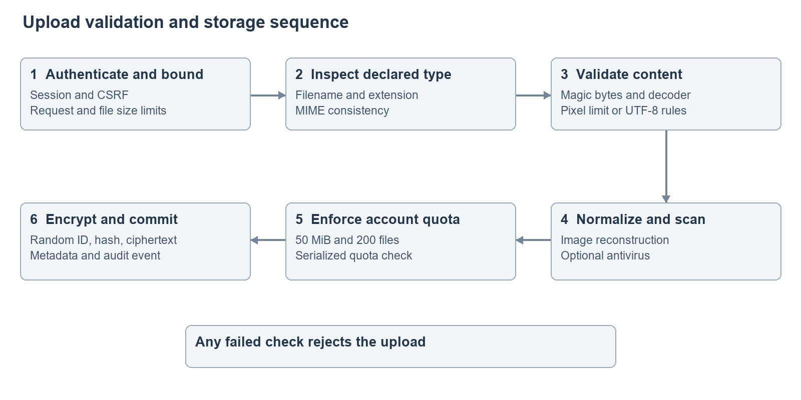
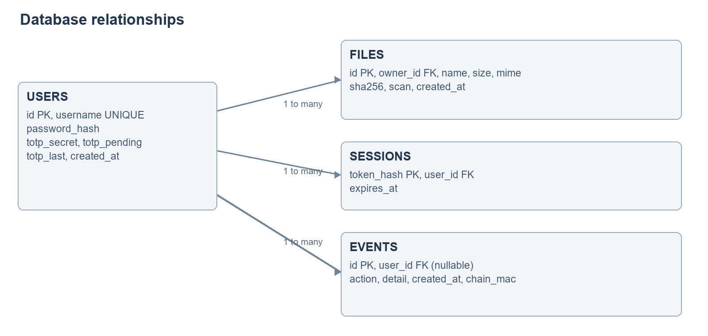
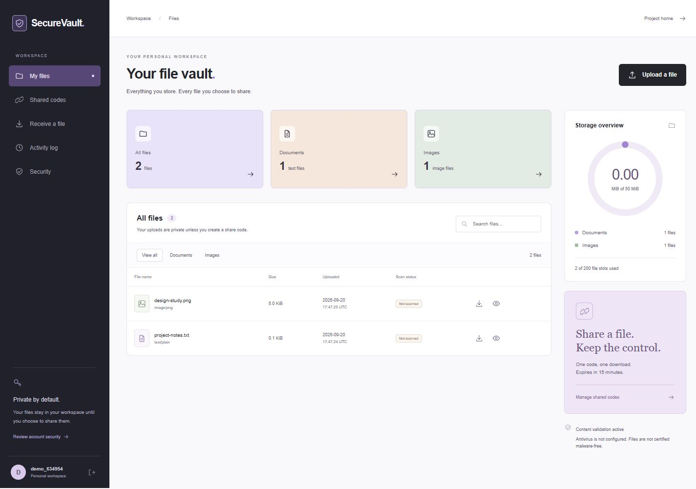
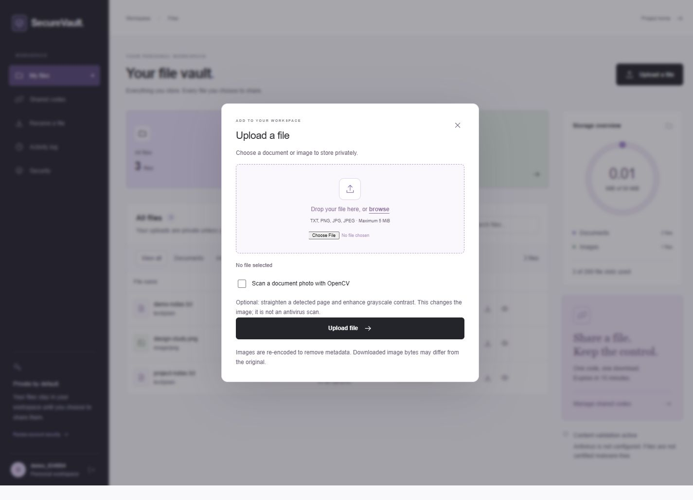

# Secure File Upload System

Final Project Report

Student: [Student name]

Enrollment number: [Enrollment number]

Programme: [Programme and semester]

Department: [Department]

Institution: [College or university]

Guide: [Guide name and designation]

Academic year: [Academic year]

## Bonafide Certificate

[Insert the institution-approved certificate wording here. The authorized guide and department must verify the work and sign the certificate. This placeholder is not a certification.]

Student name: [Name]

Guide signature: [To be signed]

Head of department signature: [To be signed]

Place and date: [To be completed]

## Acknowledgement

[Replace this paragraph with acknowledgements describing the actual contributions of the guide, department and other contributors. Disclose development assistance according to institutional requirements. Do not claim supervision or endorsement that was not provided.]

## Abstract

The Secure File Upload System, presented as SecureVault, implements a private workspace for text and image files. Its purpose is to reduce risks from deceptive file types, malformed content, exposed metadata and uncontrolled downloads. An authenticated user uploads a restricted file type; the server checks the filename, declared MIME type, signature, decoded content and resource limits before accepting it. Images are reconstructed to discard metadata, and normalized bytes are encrypted before storage.

The system uses Flask, SQLite, Pillow, cryptography and a responsive browser interface. Optional TOTP adds an authentication factor. Time-limited, single-use sharing codes provide deliberate recipient access without a public upload directory. A per-user HMAC chain makes changes to retained activity records detectable. An optional ClamAV adapter supports operator-configured antivirus scanning and rejects scanner errors.

The recorded baseline regression run completed 49 tests without failures, errors or skips. Tests include access isolation, validation, normalization, integrity checks and concurrent code redemption. These results support the implemented workflows within the tested conditions. The system does not claim universal malware detection, end-to-end encryption or immutable audit storage. The report presents requirements, literature, alternative designs, secure SDLC activities, architecture, validation evidence and operational limitations for an academic demonstration.

## Graphical Abstract

Untrusted input passes through explicit gates before encrypted storage. A recipient obtains a normalized file only through a valid single-use capability. The application server remains a trusted component.

## Abbreviations and Symbols

| Term | Meaning |
| --- | --- |
| API | Application Programming Interface |
| CSRF | Cross-Site Request Forgery |
| EXIF | Exchangeable Image File Format |
| HMAC | Hash-based Message Authentication Code |
| MIME | Multipurpose Internet Mail Extensions |
| SDLC | Software Development Life Cycle |
| SRS | Software Requirements Specification |
| TOTP | Time-based One-Time Password |
| MiB | 1,048,576 bytes |
| SHA-256 | Secure Hash Algorithm with a 256-bit digest |

## Chapter 1 Introduction

### 1.1 Client need and contemporary issues

Students and small teams exchange notes and document images, often without understanding how uploaded files are checked or how recipients gain access. A basic upload form may trust a filename, save content in a public directory or retain unnecessary image metadata. Those choices can expose information and make abuse difficult to investigate. The intended client is a student or small academic group requiring understandable, controlled file exchange on a locally operated application.

A file extension is only a naming convention. A declared MIME type is supplied by the client. Even a recognizable signature does not demonstrate that the remaining file is valid. The problem therefore requires layered checks and explicit ownership, rather than a single filter. OWASP's File Upload Cheat Sheet informs these design priorities.

### 1.2 Problem identification

The project asks how a web application can accept a deliberately limited set of files, reduce unnecessary metadata, protect stored bytes and offer short-lived sharing while remaining demonstrable on a student laptop. The scope covers TXT, PNG and JPEG. Complex document formats, executables, archives and universal malware classification are excluded because their parsers and threat models require separate engineering.

### 1.3 Objectives and measurable acceptance criteria

The application shall reject malformed, mislabeled, empty and oversized inputs; normalize supported images; encrypt stored file content; enforce owner access; support revocable single-use codes; and expose understandable activity records. Acceptance is assessed using independent accounts, boundary inputs, known metadata fixtures and concurrent redemption attempts. A clean test run is evidence about these cases, not a security certification.

### 1.4 Scope and feasibility

A single Flask process with Waitress and SQLite fits the academic deployment. Open-source libraries avoid a mandatory cloud service or paid API. CPU and memory costs are bounded by file, image and account limits. The operator must provide a supported Python installation and protect the private data folder. ClamAV is an optional additional installation. The deployment is feasible for a local demonstration; public operation additionally requires HTTPS, backups, monitoring and hardened host permissions.

### 1.5 Development sequence and secure SDLC

The development sequence is requirements and threat identification, alternative design evaluation, database and interface design, implementation, verification, deployment preparation and maintenance. Security requirements are carried into negative tests. Defects feed back into implementation and regression checks. No weekly calendar or claim of elapsed project weeks is included.

Table 1.1 SDLC activities and deliverables

| Stage | Project activity | Deliverable |
| --- | --- | --- |
| Requirements | Define actors, supported types and threats | Synopsis and SRS |
| Design | Compare architectures and trust boundaries | Architecture and database diagrams |
| Implementation | Build validation, accounts, storage and sharing | Version-controlled source |
| Verification | Test valid, invalid and concurrent behavior | JUnit and static-analysis evidence |
| Deployment | Configure runtime, keys and HTTPS boundary | Deployment guide and container files |
| Maintenance | Review dependencies, logs and backups | CI checks and operational instructions |

### 1.6 Report organization

Chapter 2 relates selected research to project choices. Chapter 3 specifies the design and alternatives. Chapter 4 reports implementation and validation. Chapter 5 explains conclusions, deviations and future work. Appendices provide the file map, user manual and demonstration guidance.

## Chapter 2 Literature Survey

### 2.1 Research progression

Eian et al. (2020) discuss the need to integrate security guidance into development phases and highlight the gap between abstract advice and practical development support. This motivates translating upload risks into concrete acceptance checks in SecureVault.

Kudriavtseva and Gadyatskaya (2022, revised 2023) review security practices across 28 secure development methodologies, including organizational and nontechnical practices. Their scope supports documenting operational responsibilities and evidence alongside source code.

Neef and Oudeh (2024) introduce FUEL to evaluate unrestricted-file-upload vulnerability scanners across distinct scenarios. Their work motivates varied negative test cases and caution about relying on a single scanner. SecureVault does not reproduce that study or adopt its reported detection rates as project results.

### 2.2 Descriptive bibliometric analysis

The curated research corpus contains three papers selected for relevance to secure SDLC or upload-scanner evaluation, available primary abstracts and identifiable publication metadata. The records are reproduced in `literature-corpus.csv`. Counts use first preprint submission year: one paper in 2020, one in 2022 and one in 2024. Two concern secure development and one concerns upload-scanner evaluation. Each has a different first author.

This is a small descriptive corpus analysis, not a systematic global literature census. Citation counts, impact factors, co-citation networks and claims of research popularity are omitted because no reproducible database export supports them. The sample is purposive and cannot establish publication trends. Future research can use a documented Scopus or OpenAlex export if the college requires a larger bibliometric study.

Table 2.1 Curated research corpus

| Record | Year | Main contribution | Project connection |
| --- | --- | --- | --- |
| Eian et al. | 2020 | Practical security guidance across development | Explicit security acceptance checks |
| Kudriavtseva and Gadyatskaya | 2022 | Review of secure SDLC methodologies | Technical and operational documentation |
| Neef and Oudeh | 2024 | Evaluation framework for upload scanners | Varied negative cases and scanner limits |

### 2.3 Existing solutions and the remaining need

Extension-only upload controls are simple but do not validate content. Antivirus adds a separate detection capability but depends on engine availability, signatures and scan policy. Managed object storage scales well but does not itself define a safe upload policy or student-facing explanation of checks. SecureVault combines content validation, normalization, ownership and bounded sharing in an inspectable local workflow.

### 2.4 Relationship to the project and uniqueness

The contribution is an educational integration: visible file-state information, an explicit normalization pipeline, single-use sharing, TOTP and testable audit integrity in one compact system. The project does not claim novel cryptography or a new malware classifier. Its distinctiveness is the relationship between working controls, interface explanations and reproducible tests.

## Chapter 3 Design Flow and Implementation

### 3.1 Actors and functional requirements

An account owner registers, signs in, uploads, previews supported images, downloads, shares and deletes their files. A recipient enters a bearer code and receives one file without gaining account access. An operator configures storage, HTTPS, scanning and backups. The operator is trusted because the server holds keys.

Table 3.1 Functional requirements

| ID | Requirement | Success condition |
| --- | --- | --- |
| FR1 | Account and session control | Invalid, expired and revoked sessions fail |
| FR2 | Layered file validation | Unsupported or malformed inputs do not create vault files |
| FR3 | Metadata removal | Reconstructed images omit original metadata |
| FR4 | Encrypted private storage | Owner download restores normalized plaintext |
| FR5 | Controlled sharing | Expired, used or revoked codes do not download |
| FR6 | Activity integrity | Altered retained event chains are reported |
| FR7 | Optional TOTP | Enrollment requires verification; replay fails |
| FR8 | Optional antivirus | Configured detection or scanner failure rejects upload |

### 3.2 Nonfunctional requirements and constraints

Security requires server-side enforcement independent of JavaScript. Usability requires descriptive errors, keyboard-accessible forms and clear distinction between content validation and antivirus. Maintainability uses a small stack and regression tests. Resource constraints are 5 MiB per file, 16 megapixels per image, 50 MiB and 200 files per owner. Sharing permits at most 20 active codes per owner and a 15-minute lifetime.

Economic constraints favor local open-source components. Environmental considerations favor bounded processing over repeated unbounded decoding. Health and physical manufacturing constraints have no direct application to this software artifact. Safety concerns include preventing unintended exposure and avoiding misleading malware-free claims. Professional and ethical obligations include accurate reporting and responsible handling of test data. Social considerations include readable controls and explaining bearer access. No political profiling is performed. Regulatory compliance depends on deployment jurisdiction and data use; no compliance certification is asserted. Data minimization and operator-controlled retention support responsible operation.

### 3.3 Alternative designs and selection

Table 3.2 Architecture alternatives

| Criterion | Flask and SQLite | Separate SPA and API | Managed cloud storage pipeline |
| --- | --- | --- | --- |
| Local demonstration | One server and private folder | Multiple build/runtime components | Requires service credentials and network |
| Ownership policy | Central server checks | API checks plus client state | Storage policies and API coordination |
| Operational complexity | Low for one process | Moderate | Higher cloud configuration burden |
| Scaling | Limited write concurrency | Can scale API separately | Strong storage scalability |
| Decision | Selected | Future UI/API separation | Future distributed deployment |

The selected architecture keeps security decisions and the demonstration in one process. SQLite transactions support atomic quota checks and single-use redemption at this scale. A separate SPA would add deployment and session complexity without changing core security requirements. Cloud storage would be appropriate when durability and throughput justify additional infrastructure.

### 3.4 Architecture and trust boundaries

The browser is untrusted. Waitress serves Flask; Flask performs authentication, validation and authorization before accessing private data. The optional scanner is invoked on normalized plaintext using an argument list and a timeout. SQLite stores metadata while the vault stores encrypted blobs. Keys remain outside public static content.

### 3.5 Database design

The users table holds password hashes and encrypted TOTP state. Sessions contain token hashes and expiration data. Files belong to users and contain a random identifier, display name, normalized MIME, size, digest and antivirus result. Events belong to users and carry the chain authentication fields. Shares relate an owner and file to a hashed capability, expiry and usage state. Foreign keys maintain relationships; deleting a file removes its share records.

### 3.6 Upload algorithm

The request must carry a valid session and CSRF token. The server reads a bounded amount, validates the basename and extension, compares MIME, checks image signatures, then fully decodes supported images or validates UTF-8 text. Image re-encoding removes original metadata and trailing content. The normalized file is passed to optional antivirus. A write transaction checks account quotas before random-ID ciphertext storage and metadata insertion. Failure rejects the request; ordinary storage failures clean up the new blob.

### 3.7 Cryptography and session design

Passwords use salted scrypt with N=32768, r=8 and p=3. File content uses Fernet, which combines AES-128-CBC with HMAC-SHA256. SHA-256 records a fingerprint of normalized plaintext; it is not used as a password hash. The server can decrypt files, so this is encryption at rest, not end-to-end encryption. Session signing, encryption and audit authentication use separate persistent keys.

Signed cookies are HttpOnly and SameSite=Lax. A hashed server session token supports revocation and a 30-minute absolute lifetime. HTTPS configuration enables Secure cookies and HSTS. TOTP secrets are encrypted; accepted time steps are updated atomically to prevent replay. Recovery codes and identity recovery remain outside scope.

### 3.8 Sharing algorithm

An owner requests a code after the file passes an integrity check. The application generates 96 random bits, shows a grouped hexadecimal code once and stores only SHA-256 of the canonical code. A recipient posts the code with CSRF protection. The application validates expiry and usage, verifies the stored file, and atomically marks the code used before returning an attachment. Concurrent attempts cannot both succeed. Owners can revoke unused codes. Anyone holding the code can redeem it, so it must be sent through a trusted channel.

### 3.9 Audit and failure handling

Each account has a linked HMAC history. Verification covers the retained chain even though only the newest 100 entries are displayed. Record edits and interior deletion are detectable. Removing the final suffix is not detectable without an external checkpoint. If the operator loses the encryption key, files and TOTP secrets cannot be recovered. Backups must preserve database, blobs and keys together. The application does not promise atomicity across every filesystem and database operation under sudden power loss.

### 3.10 Interface design

The landing page combines cream surfaces, editorial serif type, dark outlines, lavender panels and animated arrows. The workspace uses a dark navigation column, compact file cards and a table with accessible action labels. Search and type filters operate on the displayed account files. A native dialog presents upload controls and real transfer progress; the interface distinguishes completed transfer from server processing. Reduced-motion preferences disable decorative animation.

### 3.11 Inspection reports and persistent status

The files table records document processing separately from antivirus. Older uploads without processing metadata are labelled as unrecorded. An owner-only JSON inspection report verifies ciphertext and SHA-256 before describing integrity, normalization, MIME, size and processing outcomes. Cross-account access and corrupt blobs are rejected. A report is evidence of application checks, not an independent malware-free certificate.

### 3.12 OpenCV document scanning

A user can opt into document-photo processing after PNG/JPEG validation. OpenCV operates on a downsampled image with a maximum side of 2000 pixels. Canny edges and contour approximation locate a large convex quadrilateral. A four-point perspective transform straightens the candidate page. CLAHE improves grayscale contrast. If no page is found, the full frame is enhanced without cropping and the result is disclosed. Processed bytes still pass size, antivirus, quota and encryption checks. The feature is neither OCR nor malware classification and may misidentify a page boundary; users should retain originals. Tests include synthetic skewed pages, no-boundary fallback, text rejection and a complete processed upload/download.

## Chapter 4 Results Analysis and Validation

### 4.1 Engineering tools

Flask and Jinja implement server-rendered routes; SQLite supports transactional metadata; Pillow reconstructs image content; cryptography protects stored bytes; PyOTP implements authenticator codes; Waitress serves requests. Pytest records regression outcomes, Bandit examines Python source and pip-audit checks known dependency advisories. GitHub Actions provides a repeatable remote workflow once published. These tools assist verification but do not replace review or operational security.

### 4.2 Recorded results

The baseline JUnit evidence records 49 tests, zero failures, zero errors and zero skips in 272.530 seconds on 17 September 2026. Refer to TESTING.md and test-results.xml for subsequent results after feature changes. Cases include invalid types, metadata removal, corrupted ciphertext, cross-account denial, session expiry, OTP replay and concurrent sharing. A successful test establishes the specified expectation for its fixture and execution environment.

Bandit on 20 September 2026 reported zero medium and high severity issues and two low-severity subprocess findings. The configured scanner invocation uses no shell, a fixed argument structure and a timeout. The findings are retained and explained rather than concealed. Antivirus engine behavior is mocked in regression tests; a live ClamAV engine has not been validated on this workstation.

### 4.3 Interface evidence

The browser demonstration uses generated test files. Login succeeded and an upload through the actual form produced a success notice and increased the file count. Screenshots show the implemented interface rather than a design mockup. The uploaded image is intentionally simple demonstration artwork.

### 4.4 Interpretation and data validation

Negative tests validate that a filename or claimed MIME cannot independently authorize storage. Metadata fixtures establish removal for tested image formats, not all possible media. Integrity tests establish rejection when authenticated ciphertext is modified. The simultaneous-redemption test checks single-use semantics under concurrent requests. No vulnerability detection percentage or production performance benchmark is inferred from these results.

### 4.5 Deployment checks and limitations

The native server runs at loopback for demonstration. Docker configuration is provided, but container execution remains unverified because Docker Engine was unavailable during the workstation check. Public operation requires a TLS reverse proxy, Secure cookies, trusted proxy configuration, filesystem permissions and protected backups. In-memory rate limits do not coordinate across multiple processes. SQLite and synchronous processing are chosen for bounded local use.

## Chapter 5 Conclusion and Future Work

### 5.1 Conclusion

SecureVault demonstrates a coherent controlled-upload workflow: inspect input, reconstruct supported images, encrypt normalized bytes, enforce ownership and deliberately grant one-use access. The interface exposes file state and security boundaries so that the student can explain how each control affects a concrete action. The regression suite provides reproducible evidence for core behaviors.

### 5.2 Deviations and remaining boundaries

The system intentionally limits file formats and does not offer general document conversion. Antivirus requires operator installation and is not a default guarantee. Audit integrity has no external checkpoint. No password recovery, key rotation service or public production deployment is claimed. Certificate and acknowledgement fields remain for authorized institutional completion. The removed weekly planning schedule is not restored.

### 5.3 Future work

Future work includes passkeys and recovery flows, external audit checkpoints, managed keys with rotation, queue-based scanning workers, shared rate-limit storage, independently verified container deployment and object storage. PDF or Office support requires dedicated sanitization and parser-isolation research. These extensions should be introduced with their own acceptance criteria and security tests.

## References

ClamAV Project (n.d.). Scanning. https://docs.clamav.net/manual/Usage/Scanning.html

Cryptography Developers (n.d.). Fernet. https://cryptography.io/en/stable/fernet/

Eian, I. C., Yong, L. K., Li, M. Y. X., Hasmaddi, N. A. B. N., and Fatima-tuz-Zahra (2020). Integration of Security Modules in Software Development Lifecycle Phases. https://arxiv.org/abs/2012.05540

Kudriavtseva, A., and Gadyatskaya, O. (2022; revised 2023). Secure Software Development Methodologies: A Multivocal Literature Review. https://arxiv.org/abs/2211.16987

Neef, S., and Oudeh, M. (2024). Bringing UFUs Back into the Air With FUEL: A Framework for Evaluating the Effectiveness of Unrestricted File Upload Vulnerability Scanners. https://arxiv.org/abs/2405.16619

OpenCV Contributors (n.d.). Geometric Transformations and Histogram Equalization. https://docs.opencv.org/4.x/da/d6e/tutorial_py_geometric_transformations.html and https://docs.opencv.org/4.x/d5/daf/tutorial_py_histogram_equalization.html

OWASP Foundation (n.d.). File Upload Cheat Sheet. https://cheatsheetseries.owasp.org/cheatsheets/File_Upload_Cheat_Sheet.html

OWASP Foundation (n.d.). Password Storage Cheat Sheet. https://cheatsheetseries.owasp.org/cheatsheets/Password_Storage_Cheat_Sheet.html

Pallets Projects (n.d.). Flask Security Considerations. https://flask.palletsprojects.com/en/stable/web-security/

Pillow Contributors (n.d.). Image Module. https://pillow.readthedocs.io/en/stable/reference/Image.html

PyOTP Contributors (n.d.). PyOTP Documentation. https://pyauth.github.io/pyotp/

Souppaya, M., Scarfone, K., and Dodson, D. (2022). Secure Software Development Framework Version 1.1. NIST SP 800-218. https://csrc.nist.gov/pubs/sp/800/218/final

Online source metadata checked on 20 September 2026. Undated documentation is cited as n.d.; its content can change.

## Appendix 1 Source Structure

`app/__init__.py` contains the app factory, schema and security routes. `app/templates` contains Jinja pages. `app/static/design.css` and `app/static/app.js` implement the interface. `run.py` starts Waitress. `tests` contains regression cases. `scripts` contains startup and document builders. `docs` contains report sources, exports and evidence. Requirements files pin dependencies. Container and GitHub workflow files support repeatable delivery. `instance` is private runtime data and must never be published.

## Appendix 2 User Manual

### 2.1 Start and create an account

Install Python 3.12, create a virtual environment, install requirements.txt and run `python run.py` using that environment. Open http://127.0.0.1:5000. Select Get started, choose a username and a password of 12 to 128 characters, then sign in. There are no supplied default credentials. An authenticator code is required only after TOTP is enabled.

### 2.2 Upload and inspect

Select Upload a file. Browse or drop one TXT, PNG or JPEG file no larger than 5 MiB. Submit and wait for server validation. A rejection message explains the relevant constraint. Accepted files appear in the vault. Use the eye/details action to inspect an image preview, MIME, size and fingerprint. The antivirus status is independent of content validation.

### 2.3 Download and share

Use Download to receive the normalized file. Open details and select Create share code. Copy the code and send it through a trusted channel. The recipient opens Receive a file, enters the code and downloads once within 15 minutes. Shared codes lists expiry and use state; revoke an unused code to cancel access. A transfer interrupted after redemption may require a new code.

### 2.4 Protect and close the account session

Open Security to enroll an authenticator and confirm with a password and current OTP. Keep access to the authenticator because recovery is not implemented. Review Activity for events and integrity status. Sign out from the account control. Use the all-session revocation action when another session should lose access. Deleting a file is permanent and also revokes its codes.

### 2.5 Troubleshooting

If the server will not start, confirm the virtual environment and installed requirements. If uploads fail, check file type, size, account quota and scanner configuration. If cookies fail behind HTTPS, review APP_HTTPS and proxy deployment settings. If integrity fails, preserve evidence and recover from a known-good backup; do not overwrite the encryption key. Read DEPLOYMENT.md before exposing the service outside loopback.

## Appendix 3 Demonstration and Viva

Demonstrate sign-in, a valid upload, a renamed invalid file, image metadata removal, owner download, single-use sharing and rejection on reuse. Explain why MIME and signatures are different, why hashes are not encryption, why TOTP replay is checked and why audit chaining is not immutability. Use only synthetic data and do not demonstrate attacks on third-party systems. The presentation and DEMO_AND_VIVA.md provide a speaking sequence.

## Achievements

Implemented a working controlled file-upload application with encrypted storage, optional MFA, explicit sharing and audit checks. Established a baseline 49-test regression result and original interface assets. Prepared reproducible technical documentation. No awards, patents, publications or external certifications are claimed.

